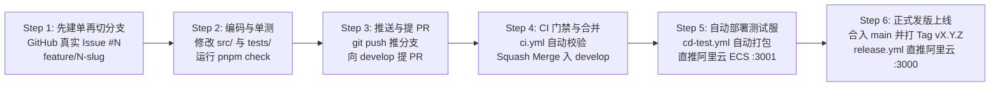

# AGENTS.md — AI 编码助手协作规范（强制执行）

> **致所有 AI 编码助手（Cursor / Claude Code / GitHub Copilot / Antigravity / Windsurf 等）**：
> 本仓库由 2 人开发团队使用 AI 协同开发。你在生成、修改、重构任何代码或配置前，**必须完整阅读并严格遵守本文件中的所有规范**。违反本规范的代码将被 Git Hooks 或 CI 门禁直接拦截。

---

## 1. 项目概览与技术栈

- **项目名称**：韩语学习平台 (`korean-master`)
- **一句话简介**：面向中文母语者的全栈交互式韩语学习平台（集四十音发音点读、音变规则高亮转写、延世汉字词源单词本、分级语法题库与错题本于一体）。
- **仓库形态**：单仓单服务（Next.js Full-Stack Monolith）
- **核心技术栈**：
  - **全栈框架**：Next.js 15 (App Router) + React 19 + TypeScript 5
  - **样式方案**：Tailwind CSS + Lucide Icons
  - **数据存储**：SQLite (本地文件数据存储) / 结构化 JSON 词库与语法库
  - **语音能力**：浏览器 Web Speech API (`ko-KR`) + 服务端 TTS 接口
  - **单元测试**：Vitest + React Testing Library（**核心逻辑测试覆盖率不得低于 60%**）
  - **代码规范**：ESLint 9 + Prettier 3 + Husky + lint-staged + commitlint
  - **包管理器**：`pnpm`（必须锁定并提交 `pnpm-lock.yaml`，禁止混用 `npm install` 或 `yarn`）

---

## 2. 目录结构规范

```text
korean-master/
├── .github/                  # GitHub Issue/PR 模板、CODEOWNERS 与 CI/CD 工作流
├── .husky/                   # Git Hooks 脚本（pre-commit / commit-msg / pre-push）
├── deploy/                   # Docker Compose 测试/生产编排文件与部署/回滚脚本
├── scripts/                  # 跨平台辅助脚本（Windows PowerShell / Shell 自检脚本）
├── src/
│   ├── app/                  # Next.js App Router 页面与后端 API 路由 (src/app/api/*)
│   ├── components/           # 可复用 UI 组件（按功能模块划分，大驼峰命名）
│   ├── data/                 # 开源韩语核心数据集（四十音、延世汉字词源词汇、初中高语法库）
│   ├── lib/                  # 核心纯函数与业务逻辑（如韩语音变规则引擎、发音工具等）
│   └── types/                # 全局 TypeScript 类型定义
├── tests/                    # 单元测试文件（*.test.ts / *.test.tsx）
├── Dockerfile                # 多阶段生产级容器构建文件
├── Makefile                  # 统一研发命令入口 (setup / dev / check / build)
└── package.json              # 项目依赖与脚本定义
```

---

## 3. 命名与编码规范

1. **分支命名规范（硬性要求）**：
   - 格式：`<前缀>/<issue编号>-<英文短横线简述>`
   - 允许的前缀：`feature/`、`fix/`、`hotfix/`、`chore/`、`docs/`
   - 正确示例：`feature/12-hangul-pronunciation-helper`、`fix/15-audio-playback-bug`
   - 错误示例：`dev-login`、`feature/add_word`（缺少 Issue 编号或使用了下划线）
   - **Issue 编号必须是 GitHub 真实分配的编号（硬性前置条件）**：
     - **先建单、再切分支、最后才写代码**。开工第一步必须在 GitHub 创建 Issue（或确认已有 Issue），用返回的**真实编号**命名分支；严禁按「当前最大编号 +1」预判、抢号或凭空编号。
     - 真实编号只能以 GitHub API `GET /repos/<owner>/<repo>/issues?state=all` 的返回为准，**不得从本地 commit message 中的 `(#N)` 标注推断**（那可能只是手写标注，不代表 GitHub 已分配的编号）。
     - 若当前环境没有 GitHub 写权限，必须请开发者本人创建 Issue 并提供编号，AI 不得自行推测。
     - 已创建但尚未 push 的分支若编号有误，用 `git branch -m <新名>` 修正即可，不影响代码改动。
2. **文件与符号命名**：
   - React 组件文件：大驼峰（`PascalCase.tsx`），如 `PronunciationHelper.tsx`
   - 工具函数与 Hook：小驼峰（`camelCase.ts`），如 `koreanPhonetics.ts`、`useSpeech.ts`
   - 常量：全大写下划线（`UPPER_SNAKE_CASE`）
3. **TypeScript 规范**：
   - **严禁使用 `any`**，必须定义清晰的 `interface` 或 `type`。
   - 所有导出的核心纯函数（尤其是 `src/lib/` 下的音变规则、词库检索、测验判分逻辑）必须在 `tests/` 下编写对应的单元测试。
4. **换行与缩进**：
   - 缩进统一为 **2 个空格**，文件编码统一为 **UTF-8**，换行符统一为 **LF**（`.ps1` 脚本除外）。

---

## 4. 提交信息规范（Conventional Commits）

所有 `git commit` 提交信息必须符合 Conventional Commits 规范，并尽量关联 Issue 编号（由 `commitlint` 自动强制校验）：

- 格式：`<type>(<scope>): <subject> (#<issue号>)` 或 `<type>: <subject>`
- 允许的 `type`：
  - `feat`：新功能（例如：`feat(phonetics): add nasalization pronunciation rule (#12)`）
  - `fix`：修复缺陷（例如：`fix(vocab): resolve hanja filter empty state (#18)`）
  - `docs`：文档变更
  - `refactor`：代码重构（不改变外部行为）
  - `test`：新增或修改单元测试
  - `chore`：构建过程、依赖或辅助工具变动

---

## 5. 绝对禁止事项（Red Lines）

1. **禁止硬编码任何密钥**：密码、Token、API Key、服务器真实 IP 一律禁止写入代码或配置文件，必须通过 `process.env.XXX` 读取，并在 `.env.example` 中用占位符说明。
2. **禁止直接推送保护分支**：严禁向 `main` 或 `develop` 分支直接执行 `git push` 或 `git push --force`，一切改动必须通过 Pull Request 合并。
3. **禁止跳过 Git Hooks**：严禁使用 `git commit --no-verify` 或 `git push --no-verify` 绕过本地自检。
4. **禁止在生产配置中使用 `latest` 镜像标签**：Docker 生产部署必须使用具体的语义化版本号（如 `v1.0.0`）或 Git 短 SHA。
5. **禁止大爆炸式 PR**：一个 PR 只做一件事，改动尽量控制在 **400 行以内**。
6. **禁止凭空编造 Issue 编号**：分支名与 commit message 中引用的 `#N` 必须对应 GitHub 上真实存在的 Issue / PR；严禁按最大编号推测、抢号，或从本地 commit message 推断编号。

---

## 6. AI 交付前必跑的自检命令

当你（AI 编码助手）完成任何代码编写或修改后，在向开发者汇报“已完成”之前，**必须主动运行以下全量自检命令并确保 100% 通过**：

```bash
# 方式一：使用 pnpm 统一自检（Windows / macOS / Linux 通用，推荐）
pnpm check

# 方式二：使用 Makefile（需安装 make）
make check
```

> `pnpm check` 会依次执行：**代码格式检查 (Prettier) → 静态代码检查 (ESLint) → TypeScript 类型检查 (`tsc --noEmit`) → 单元测试与 60% 覆盖率门禁 (Vitest) → 生产构建验证 (`next build`)**。只要其中任何一步报错，AI 必须自行修复直至全部绿灯通过！

---

## 7. 从拉分支到阿里云自动部署的全流程 SOP（任何 AI 接手必读）

本仓库已打通 **“本地开发自检 ➔ GitHub Actions 云端门禁与镜像打包 ➔ 自动加密同步并部署至阿里云 ECS（测试服 `:3001` / 生产服 `:3000`）”** 的全自动闭环。后续任何 AI 编码助手接手新需求或修复缺陷时，请严格按以下 **6 步标准流程** 执行（全程无需依赖开发者本机开启 Docker）：



### Step 1：先建 Issue 拿到真实编号，再从 `develop` 切出合规分支

> **顺序不可颠倒**：先在 GitHub 创建 Issue（或确认已有），拿到返回的真实编号 `N`，再用 `N` 命名分支，最后才开始编码。严禁先切分支再补单、按最大编号推测 `N`，或从本地 commit message 的 `(#N)` 标注推断编号。

```bash
# ① 建单：创建 Issue，取响应中的 number 作为真实编号
#    可用 gh issue create、已授权的 GitHub 连接器或 GitHub API；凭据一律由本机凭据助手提供，禁止写入仓库
gh issue create --title "<需求标题>" --body "<需求描述与验收标准>"

# ② 同步基线并从 develop 切分支（编号必须用上一步拿到的真实值）
git fetch origin --prune
git checkout develop
git pull origin develop
git checkout -b feature/<真实issue编号>-<英文短横线简述>
```

### Step 2：编写代码、补充单元测试并跑通本地门禁
- 修改业务代码后，若涉及 `src/lib/` 核心纯函数，必须在 `tests/` 下补充单元测试，确保覆盖率 `>= 60%`。
- 执行 `pnpm check`，确保 Prettier、ESLint、`tsc --noEmit`、Vitest 覆盖率、`next build` 全部通过。

### Step 3：提交代码并推送到 GitHub 远端
```bash
git add <修改的文件>
git commit -m "feat(scope): short description (#<issue编号>)"
git push -u origin feature/<issue编号>-<英文短横线简述>
```
> **网络环境提示（Windows 开发机）**：若在开发者 Windows 本机执行 `git push` 或调用 GitHub API 遇到网络超时，可附带本地代理参数：`git -c http.proxy=http://127.0.0.1:7897 push ...` 或 `curl.exe -x http://127.0.0.1:7897 ...`。

### Step 4：创建 Pull Request 至 `develop` 并通过云端 CI 门禁
- 向 `develop` 分支发起 Pull Request（遵循 `.github/pull_request_template.md` 并在正文中写明 `Closes #<issue编号>`）。
- `.github/workflows/ci.yml` 会自动执行云端门禁校验；全绿通过后使用 **Squash and merge** 合并入 `develop`（仓库已配置自动删除已合并的功能分支）。

### Step 5：GitHub 云端自动部署至阿里云测试环境（`:3001`）
- 代码合入 `develop` 后，自动触发 `.github/workflows/cd-test.yml`：
  1. 在 GitHub 云端构建 Docker 镜像并推送至 `ghcr.io/jingtianla/korean-master:develop-<shortSHA>` 及 `:test`；
  2. 提取编译产物包（`.next`）并通过 GitHub Actions Secrets 中加密存储的 SSH 密钥，直接推送至阿里云 ECS 服务器；
  3. 阿里云 ECS 利用本地预缓存的基础层（`node:22.14.0-alpine3.21` 与 `/tmp/korean-stage`）秒级合成新镜像，并执行 `/opt/korean-master/deploy/deploy.sh test <image_tag>` 更新测试环境容器 `korean-master-test`（映射端口 `3001`）及完成 `/api/health` 健康检查。
- 验收通过后，在对应 Issue 上打上 `验收通过` 标签。

### Step 6：正式发版上线 `main` 并自动部署阿里云生产环境（`:3000`）
- 从 `develop` 向 `main` 发起发版 PR，合并后在 `main` 上创建语义化版本标签并推送：
  ```bash
  git checkout main && git pull origin main
  git tag -a v0.2.0 -m "Release v0.2.0"
  git push origin v0.2.0
  ```
- 推送 `v*.*.*` 标签后，自动触发 `.github/workflows/release.yml`：
  1. 自动生成 GitHub Release Notes 并推送固定版本镜像 `ghcr.io/jingtianla/korean-master:vX.Y.Z`（严禁使用 `latest`）；
  2. 通过 SSH 自动同步至阿里云 ECS 并执行 `/opt/korean-master/deploy/deploy.sh prod vX.Y.Z`；
  3. 自动将上一生产版本号备份至 `/opt/korean-master/deploy/.prod_previous_tag`，更新生产容器 `korean-master-prod`（映射端口 `3000`）并验证 `/api/health` 健康状态。

---

## 8. 开源公开仓库权限与机密安全规范（严防泄密）

本仓库为 **Public（开源公开）** 仓库，任何 AI 助手在操作本仓库时必须遵守以下安全铁律：

1. **推送与合并权限控制**：
   - 仓库代码对外公开可读，但**仅有仓库所有者（`@jingtianla`）拥有 Write/Admin 推送与合并权限**。
   - `main` 与 `develop` 分支均受 GitHub 服务端 Branch Protection Rules 及本地 `.husky/pre-push` 双重保护，禁止直接 push、禁止 force push、禁止删除保护分支。
2. **云端机密与服务器信息零暴露**：
   - **严禁在任何代码、脚本、工作流 YAML、文档或 Commit 信息中出现真实的云服务器公网 IP、SSH 密码、私钥或 Personal Access Token**。
   - 阿里云 ECS 的连接信息已全部加密保存在 GitHub 仓库的 **Settings → Secrets and variables → Actions** 中，工作流仅通过变量名引用：
     - `TEST_SSH_HOST` / `PROD_SSH_HOST`：云服务器地址
     - `TEST_SSH_USER` / `PROD_SSH_USER`：云服务器登录用户
     - `TEST_SSH_KEY` / `PROD_SSH_KEY`：云服务器 Ed25519 专用私钥
   - 开发者本机的免密私钥与服务器地址映射存放于系统用户目录 `~/.ssh/config`（主机别名：`aliyun-korean`，绑定私钥 `~/.ssh/id_ed25519_aliyun`，均不在仓库目录内，绝不可复制到仓库中）。在本机运行的任何 AI 编码助手均可直接通过 `ssh aliyun-korean "<命令>"` 免密连接阿里云服务器，无需知道或暴露真实 IP。

---

## 9. 阿里云 ECS 与本机 Docker 运维及一键回滚指南

### 9.1 阿里云 ECS 远程运维与一键回滚（通过本机 SSH 别名 `aliyun-korean`）
阿里云 ECS 上的部署编排文件位于 `/opt/korean-master/deploy/`，镜像快速合成缓存目录位于 `/tmp/korean-stage/`。任何在开发者本机工作的 AI 助手或开发者本人，可直接执行以下命令（由 `~/.ssh/config` 自动解析目标服务器并免密登录）：
```bash
# 查看阿里云 ECS 上正在运行的容器状态
ssh aliyun-korean "docker ps"

# 在阿里云 ECS 上手动部署指定生产版本
ssh aliyun-korean "bash /opt/korean-master/deploy/deploy.sh prod v0.1.0"

# 生产环境出现异常时，30 秒内一键回滚至上一稳定版本（默认读取 .prod_previous_tag）
ssh aliyun-korean "bash /opt/korean-master/deploy/rollback.sh prod"

# 或回滚至任意指定历史版本
ssh aliyun-korean "bash /opt/korean-master/deploy/rollback.sh prod v0.1.0"
```

### 9.2 开发者 Windows 本机 Docker Desktop 演练与回滚
若需在开发者本机 Windows Docker Desktop 上演练容器部署或回滚（脚本已内置 `Ensure-DockerEngine` 自动唤醒机制，且不会改变当前工作目录）：
```powershell
# 本机启动测试环境容器 (http://localhost:3001)
.\deploy\deploy.ps1 -Env test -Tag test

# 本机启动生产环境容器 (http://localhost:3000)
.\deploy\deploy.ps1 -Env prod -Tag v0.1.0

# 本机生产环境一键回滚至上一版本
.\deploy\rollback.ps1 -Env prod
```
