# 🤝 团队协作开发指南 (CONTRIBUTING.md)

欢迎加入 **韩语学习平台 (`korean-master`)** 开发团队！
我们采用 **「`main`（生产）+ `develop`（测试）+ 功能分支」** 分支模型，全员使用 AI 协同编码。本文档手把手教你完成从“领任务”到“发版上线与回滚”的每一步，新手照着复制粘贴即可完成全部操作。

---

## 一、15 步研发全流程总览图 (Mermaid)

```mermaid
flowchart TD
    subgraph Plan["阶段一：领任务与拉分支"]
        S1["1. 建/领 Issue (#12)<br/>明确需求与【验收标准】"] --> S2["2. 从 develop 切分支<br/>feature/12-xxx 或 fix/12-xxx"]
    end

    subgraph Dev["阶段二：AI 辅助编码与本地自检"]
        S2 --> S3["3. 本地开发 (遵守 AGENTS.md)<br/>编写代码 + 单元测试"]
        S3 --> S4["4. 本地全量自检 (pnpm check)<br/>Git Hooks 自动校验格式/Commit规范/60%覆盖率"]
        S4 --> S5["5. 推送远程同名分支<br/>git push -u origin feature/12-xxx<br/>(严禁直接 push main/develop)"]
    end

    subgraph PR["阶段三：PR 门禁与代码评审"]
        S5 --> S6["6. 发起 Pull Request (-> develop)<br/>填写 PR 模板并关联 Closes #12"]
        S6 --> S7["7. GitHub CI 门禁自动运行<br/>分支命名校验 + Lint + 单测覆盖率 + 构建"]
        S7 --> S8["8. 代码评审 (Code Review)<br/>至少 1 名 Reviewer Approve<br/>新提交自动使旧 Approve 失效"]
        S8 --> S9["9. Squash Merge 合并入 develop<br/>自动删除源功能分支"]
    end

    subgraph TestEnv["阶段四：测试环境自动部署与验收"]
        S9 --> S10["10. CD 自动构建并推送镜像<br/>标签：develop-<短SHA> & test"]
        S10 --> S11["11. 自动/本机部署测试环境<br/>docker compose up -d + /api/health 健康检查"]
        S11 --> S12["12. 测试验收<br/>按 Issue【验收标准】逐条打勾<br/>打上「验收通过」标签"]
    end

    subgraph ProdEnv["阶段五：正式发版、审批上线与回滚"]
        S12 --> S13["13. 发版：develop 合并入 main<br/>打标签 vX.Y.Z -> 构建版本镜像 & Release Notes"]
        S13 --> S14["14. 生产环境审批部署<br/>负责人 @jingtianla 在 production 环境点击 Approve<br/>拉取 vX.Y.Z 镜像重启并备份上一版本"]
        S14 -. "发现线上异常时" .-> S15["15. 一键快速回滚<br/>执行 rollback.sh / rollback.ps1<br/>10秒切回上一稳定版本"]
    end
```



---

## 二、日常开发 10 条命令速查卡（建议收藏）

> 💡 **在哪里执行**：打开 **Windows PowerShell**，先执行第 1 条进入项目目录，再复制对应命令。

| 序号 | 场景 | 直接复制执行的命令 | 说明 |
| :---: | :--- | :--- | :--- |
| **1** | **进入项目目录** | `cd "D:\AI\11.韩语"` | 每次打开新终端窗口的第一步 |
| **2** | **同步最新测试分支** | `git checkout develop; git pull origin develop` | 开发新功能前，先确保本地 `develop` 是最新的 |
| **3** | **新建功能分支** | `git checkout -b feature/12-hangul-audio` | 格式必须是 `feature\|fix\|hotfix\|chore\|docs/<issue号>-<简述>` |
| **4** | **启动本地开发网站** | `pnpm dev` | 启动后浏览器打开 `http://localhost:3000` 实时预览 |
| **5** | **自动格式化代码** | `pnpm format` | 一键用 Prettier 修好所有缩进和引号格式问题 |
| **6** | **一键全量自检（必跑）** | `pnpm check` | 依次跑：格式 + ESLint + TS类型 + 单测60%覆盖率 + 构建 |
| **7** | **规范提交代码** | `git add .; git commit -m "feat(phonetics): add audio speed toggle (#12)"` | 提交信息必须以 `feat:` / `fix:` / `docs:` / `test:` / `chore:` 开头 |
| **8** | **推送功能分支到远程** | `git push -u origin feature/12-hangul-audio` | 推送前 Git Hook 会自动校验分支名并重跑单元测试 |
| **9** | **打标签触发正式发版** | `git checkout main; git pull; git tag v1.0.0; git push origin v1.0.0` | 在 `main` 分支打 `vX.Y.Z` 标签，自动触发生产发版流水线 |
| **10** | **生产环境一键回滚** | `.\deploy\rollback.ps1 -Env prod` | 把生产容器镜像切回上一个稳定版本并重做健康检查 |

---

## 三、从领任务到上线的 15 步手把手操作详解

### 第 1 步：领任务（先建 Issue，无 Issue 不写代码）
1. 打开 GitHub 仓库页面 → 点击顶部 **Issues** → 点击绿色按钮 **New issue**。
2. 选择 **「✨ 功能需求 (Feature Request)」** 或 **「🐛 缺陷报告 (Bug Report)」**。
3. 填写需求描述与**「验收标准」**后提交，记下生成的编号（例如 **`#1`**）。

### 第 2 步：从 `develop` 拉分支
打开 PowerShell，执行：
```powershell
cd "D:\AI\11.韩语"
git checkout develop
git pull origin develop
git checkout -b feature/1-add-topik-words
```
> ⚠️ **紧急线上修复特例**：如果是生产环境紧急 Bug，从 `main` 拉取 `hotfix/<issue号>-<简述>` 分支。

### 第 3 步：改代码（使用 AI 编码助手）
1. 在编辑器里让 AI 帮你写代码，提示词里加上一句：**“请严格遵守根目录 `AGENTS.md` 规范，并在 `tests/` 下补充对应单元测试，最后跑通 `pnpm check`。”**
2. 严禁在代码中硬编码任何真实密码或 API Key，环境变量统一写在 `.env`（本地生效，不进 Git）并在 `.env.example` 留占位符。

### 第 4 步：本地自检
提交前执行全量自检命令：
```powershell
cd "D:\AI\11.韩语"
pnpm check
```
确认全部绿灯后执行提交：
```powershell
git add .
git commit -m "feat(vocab): add topik level 1 words (#1)"
```
*(此时 `.husky/pre-commit` 会自动格式化代码，`.husky/commit-msg` 会自动检查提交信息格式，格式不对会提示你重填。)*

### 第 5 步：推代码到远程同名分支
```powershell
git push -u origin feature/1-add-topik-words
```
*(注意：如果有人试图在 `main` 或 `develop` 分支直接执行 `git push`，会被本地 `.husky/pre-push` 和 GitHub 分支保护规则双重拦截！)*

### 第 6 步：在 GitHub 网页发起 Pull Request (PR)
1. 打开 GitHub 仓库页面，点击顶部黄条提示的 **Compare & pull request**。
2. **注意方向**：`base` 选 **`develop`**，`compare` 选你的 **`feature/1-add-topik-words`**。
3. 按照自动加载的 PR 模板填好：
   - `Closes #1`（合并后会自动关闭 1 号 Issue）
   - 改了什么、为什么改、怎么测的、前端改动截图。
4. 点击 **Create pull request**。

### 第 7 ~ 9 步：CI 门禁、Review 与 Squash Merge
1. PR 创建后，`ci.yml` 自动运行（检查分支名、Lint、单测覆盖率、构建）。
2. 找队友（或 Reviewer）在 PR 页面点击 **Files changed → Review changes → Approve**。
3. CI 全绿 + 1 人 Approve 后，点击绿色按钮 **Squash and merge**（合并后 GitHub 会自动删除源功能分支）。

### 第 10 ~ 12 步：测试环境部署与验收
1. 代码合入 `develop` 后，`cd-test.yml` 自动构建镜像 `ghcr.io/jingtianla/korean-master:test` 与 `develop-<短SHA>`。
2. 在测试电脑上拉起最新测试环境容器：
   ```powershell
   cd "D:\AI\11.韩语"
   .\deploy\deploy.ps1 -Env test -Tag test
   ```
3. 打开测试环境 `http://localhost:3001`，对照 Issue `#1` 中的**「验收标准」**逐条打勾测试，全部通过后在 Issue 上打上 `验收通过` 标签。

### 第 13 ~ 15 步：正式发版、审批上线与回滚
1. 在 GitHub 上发起一个从 `develop` 到 `main` 的发版 PR，审批并合并入 `main`。
2. 在本地拉取最新 `main` 并打上语义化版本标签推送：
   ```powershell
   cd "D:\AI\11.韩语"
   git checkout main
   git pull origin main
   git tag v1.0.0
   git push origin v1.0.0
   ```
3. GitHub Actions 的 `release.yml` 自动构建 `v1.0.0` 镜像并生成 Release Notes，然后停在 **`production` 环境等待负责人 `@jingtianla` 点击 Approve**。
4. 生产部署或本机更新生产容器：
   ```powershell
   .\deploy\deploy.ps1 -Env prod -Tag v1.0.0
   ```
5. 如果发现新版本有问题，执行一键回滚命令（10 秒切回上一版本）：
   ```powershell
   .\deploy\rollback.ps1 -Env prod
   ```
